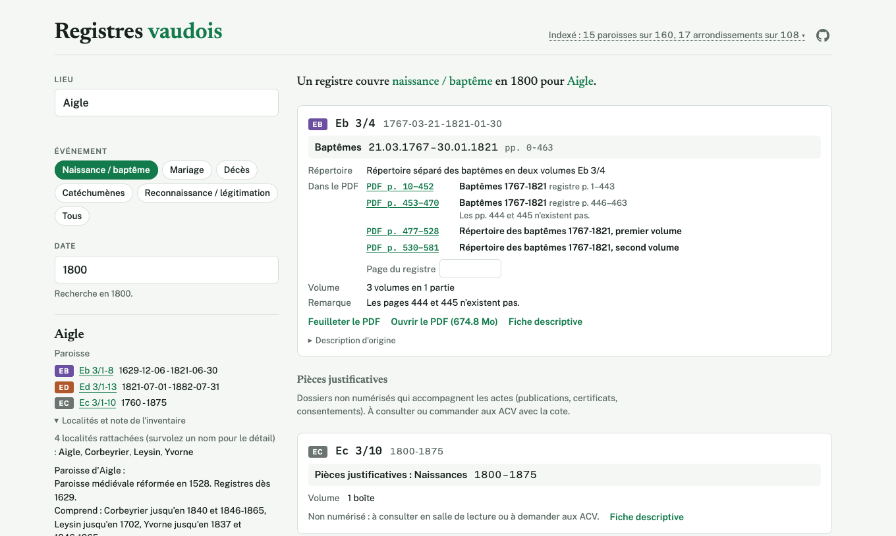
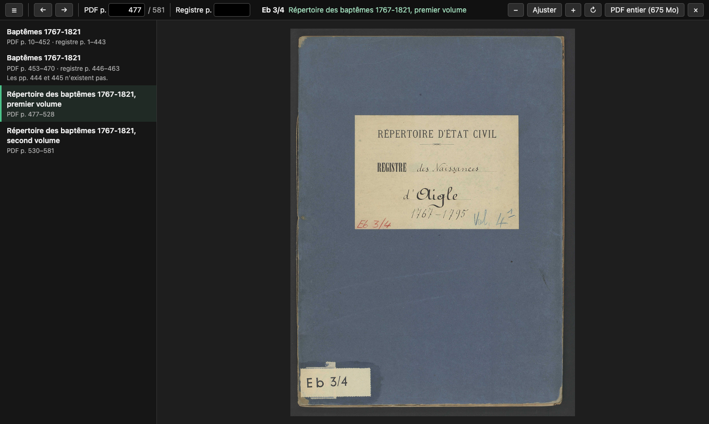

# Registres vaudois

Un index pour faciliter les recherches dans les registres d'état civil des Archives cantonales vaudoises (ACV) : https://nyg.github.io/acv-genealogie-index/

Le projet a trois fonctions :

1. trouver le registre à ouvrir pour un lieu, un événement et une date ;
2. aller directement au bon endroit du PDF, par exemple au répertoire ;
3. ouvrir le PDF à la page voulue sans le télécharger en entier, avec le sommaire du registre.

## Sommaire

- [1. Trouver le registre](#1-trouver-le-registre)
- [2. Aller au répertoire dans le PDF](#2-aller-au-répertoire-dans-le-pdf)
- [3. Ouvrir le PDF à la bonne page, sans le télécharger](#3-ouvrir-le-pdf-à-la-bonne-page-sans-le-télécharger)
  - [Installer le script](#installer-le-script)
  - [Utiliser le script](#utiliser-le-script)
- [État du projet](#état-du-projet)
- [Sources et licence](#sources-et-licence)
- [Développement](#développement)
  - [Ajouter des séries](#ajouter-des-séries)
  - [Pages des PDF](#pages-des-pdf)
  - [Tables de correspondance](#tables-de-correspondance)
  - [Tests](#tests)

## 1. Trouver le registre

Pour une paroisse ou une commune, un type d'événement et une date, l'index donne le registre à ouvrir. Par exemple, une naissance en 1800 à Aigle se trouve dans le registre Eb 3/4.



## 2. Aller au répertoire dans le PDF

L'index analyse aussi le contenu des PDF. Pour Eb 3/4, il indique que le registre commence à la page 10 du PDF et que les deux répertoires commencent aux pages 477 et 530 : on peut donc se rendre directement au répertoire.

Une fois le nom trouvé dans le répertoire, il suffit de saisir dans « Page du registre » la page qu'il cite pour obtenir la page du PDF correspondante.

Ce travail se fait registre par registre. Il couvre pour l'instant Ollon, Bex, Aigle, Ballaigues, Château-d'Oex et L'Étivaz. Ailleurs, le PDF s'ouvre à sa première page.

## 3. Ouvrir le PDF à la bonne page, sans le télécharger

Les PDF de davel-vd.ch pèsent souvent plusieurs centaines de Mo, et le navigateur en télécharge l'essentiel avant d'afficher la page demandée. Le script d'aperçu ne lit que la page affichée (environ 1 Mo) : l'ouverture est très rapide, et le sommaire de l'index s'affiche à côté du PDF.



### Installer le script

Le script fonctionne avec l'extension Tampermonkey, dans Chrome ou Firefox sur ordinateur.

Dans Chrome :

1. Installer [Tampermonkey pour Chrome](https://chromewebstore.google.com/detail/tampermonkey/dhdgffkkebhmkfjojejmpbldmpobfkfo).
2. Dans `chrome://extensions`, ouvrir les détails de Tampermonkey et activer « Autoriser les scripts utilisateur » (« Allow User Scripts »). Avant Chrome 138, activer plutôt le « Mode développeur », en haut à droite de cette page.
3. Ouvrir https://nyg.github.io/acv-genealogie-index/apercu.user.js et cliquer sur « Installer ».
4. Recharger le site de l'index.

Dans Firefox :

1. Installer [Tampermonkey pour Firefox](https://addons.mozilla.org/fr/firefox/addon/tampermonkey/).
2. Ouvrir https://nyg.github.io/acv-genealogie-index/apercu.user.js et cliquer sur « Installer ».
3. Recharger le site de l'index.

Tampermonkey met ensuite le script à jour tout seul.

### Utiliser le script

Les liens « PDF p. » de l'index ouvrent la fiche du registre sur davel-vd.ch avec la page demandée par-dessus, et « Feuilleter le PDF » s'ajoute aux liens de chaque registre. Sur davel-vd.ch, chaque fiche qui a un PDF reçoit aussi un bouton « Feuilleter le PDF page par page ». Le script tourne sur davel-vd.ch, car ce site n'autorise pas les autres, dont celui de l'index, à lire ses PDF.

Le script fonctionne aussi sur le catalogue du [Staatsarchiv Zürich](https://suche.staatsarchiv.djiktzh.ch/) : chaque fiche qui a un PDF reçoit un bouton « PDF seitenweise durchblättern ». Les pages de ces PDF sont au format JPEG 2000, que les navigateurs n'affichent pas : le script charge donc [pdf.js](https://mozilla.github.io/pdf.js/) depuis jsDelivr pour les décoder. Il n'y a pas de sommaire pour ces PDF.

| Commande | Effet |
| --- | --- |
| ← et → | changer de page (les pages voisines sont chargées à l'avance) |
| clic sur la page | agrandir à la largeur de l'écran |
| + et − | régler le zoom |
| R | faire pivoter la page |
| ☰ ou S | afficher ou masquer le sommaire |
| Échap | fermer l'aperçu |

« PDF entier » ouvre le fichier complet à la même page. Pour les registres dont les pages sont reliées au PDF, le sommaire liste les parties du registre, « Registre p. » mène à la page citée par le répertoire, et la barre indique la partie et la page du registre affichées.

## État du projet

L'index n'est pas complet : les paroisses et arrondissements sont ajoutés progressivement, et le site indique en haut de page ce qui est déjà couvert. Si certaines communes sont prioritaires pour vous, ou pour tout retour, [ouvrez une issue](https://github.com/nyg/acv-genealogie-index/issues).

Le projet est réalisé avec l'IA (Claude) et il est open source.

## Sources et licence

- [davel-vd.ch](https://davel-vd.ch) : registres numérisés, avec PDF. Registres paroissiaux (Eb, 1562-1821), état civil cantonal (Ed, 1821-1875), état civil fédéral par arrondissement (SB 267, dès 1876).
- [davel.vd.ch](https://davel.vd.ch) : inventaire général, sans PDF. Promesses de mariage (SB 268), événements hors arrondissement (SB 269), pièces justificatives (Ec, SB 23, SB 115, SB 324).
- Tables de correspondance des ACV, communes et localités vers paroisses (jusqu'en 1875) et vers arrondissements d'état civil (1876-1960).

Les données sont publiées par les ACV sous licence [CC BY-SA 4.0](https://creativecommons.org/licenses/by-sa/4.0/deed.fr) ; les données dérivées de ce dépôt (`data/`, `docs/index.html`, `docs/images/`) le sont aussi.

## Développement

### Ajouter des séries

La marche à suivre complète, pour un agent, est dans `.claude/skills/acv-scraping/SKILL.md`. En résumé :

```bash
python3 scraper/plan.py davel-vd --fonds eb --match "ollon|huemoz"
```

Coller dans la console de davel-vd.ch le contenu de `scraper/davel_vd.js`, puis les appels affichés par `plan.py` (`acv.enqueue(...)`, puis `acv.exportSeries(...)` une fois le lot terminé). Pour davel.vd.ch, même chose avec `plan.py davel --fonds "SB 268"` et `scraper/davel_scopearchiv.js`.

Enregistrer l'export avec `python3 scraper/save_export.py <fichier> [davel|davel-index]`, puis :

```bash
scripts/check.sh
```

### Pages des PDF

La marche à suivre pour ajouter des registres à `data/manual/pdf-pages.json` est dans `.claude/skills/acv-pdf-pages/SKILL.md`. Les PDF n'ont pas de texte : les numéros de page se lisent sur les images.

### Tables de correspondance

```bash
curl -O https://www.vd.ch/fileadmin/user_upload/themes/etat_droit/archives_cantonales/Fichiers-PDF/doc-etat-civil_correspondance_communes-paroisses.pdf
curl -O https://www.vd.ch/fileadmin/user_upload/themes/etat_droit/archives_cantonales/Fichiers-PDF/doc-etat-civil_correspondance_communes-arrondissements.pdf
uv run --with pdfplumber scraper/parse_correspondence.py
```

Les deux PDF vont dans `data/raw/vd-ch/`.

### Tests

`scripts/check.sh` lance `uvx pytest -q tests`, `node tests/site_smoke.mjs`, `node tests/pdf_probe.mjs` et `node tests/apercu.mjs`. Le test de fumée exécute le script du site sur des recherches réelles (lieu, acte, date) et vérifie que la bonne cote ressort, et que les pages du registre tombent sur la bonne page du PDF.
